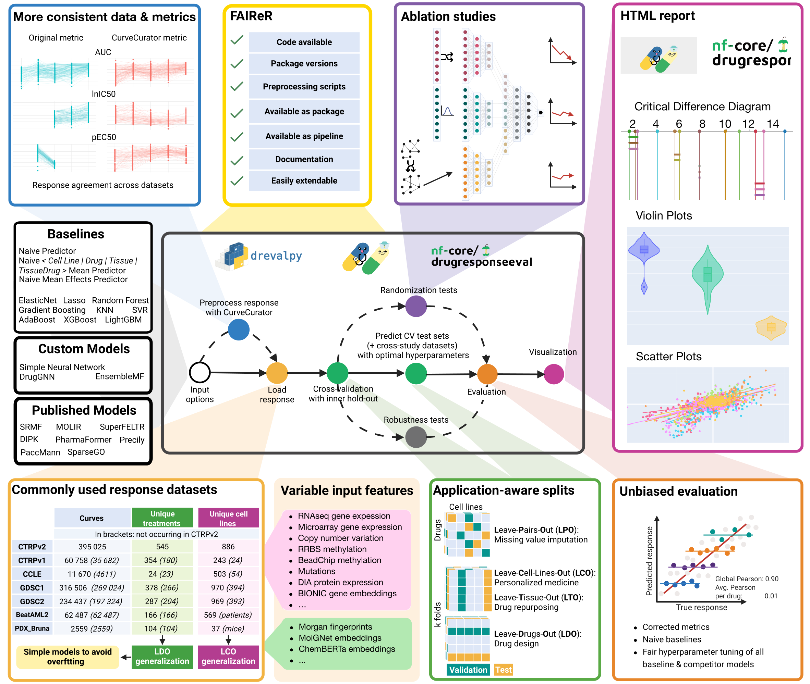

# DrEvalPy: Python Drug Response Prediction Suite

[](https://doi.org/10.1038/s41467-026-72903-w)
[](https://pypi.org/project/drevalpy/)

[](https://opensource.org/licenses/MIT)
[](https://drevalpy.readthedocs.io/)
[](https://github.com/daisybio/drevalpy/actions?workflow=Tests)
[](https://github.com/pre-commit/pre-commit)
[](https://github.com/astral-sh/ruff)
[](https://doi.org/10.5281/zenodo.18302237)

**News:** Our paper is out on [Nature Communications](https://www.nature.com/articles/s41467-026-72903-w)!

**Focus on Innovating Your Models — DrEval Handles the Rest!**

- DrEval is a toolkit that ensures drug response prediction evaluations are statistically sound, biologically meaningful, and reproducible.
- Focus on model innovation while using our automated standardized evaluation protocols and preprocessing workflows.
- A flexible model interface supports all model types (e.g. Machine Learning, Stats, Network-based analyses)

By contributing your model to the DrEval catalog, you can increase your work's exposure, reusability, and transferability.



---

Use DrEval to build drug response models that have an impact

1. Maintained, up-to-date baseline catalog, no need to re-implement literature models
2. Gold standard datasets for benchmarking
3. Consistent application-driven evaluation
4. Ablation studies with permutation tests
5. Optimized nextflow pipeline for fast experiments
6. Easy-to-use hyperparameter tuning
7. Paper-ready visualizations to display performance

---

<picture>
  <source media="(prefers-color-scheme: dark)" srcset="docs/_static/img/leaderboard_dark.png?v=4">
  <source media="(prefers-color-scheme: light)" srcset="docs/_static/img/leaderboard_light.png?v=4">
  
</picture>

---

This project is a collaboration of the Technical University of Munich (TUM, Germany)
and the Freie Universität Berlin (FU, Germany).

> **Coming from DrEvalPy 1.x?** v2 is a rewrite and nothing that 1.x wrote loads in it. Read the
> [migration guides](https://drevalpy.readthedocs.io/en/latest/how-to/migrate/index.html) first.
> Until v2 is released, `pip install drevalpy` installs 1.6.0; install v2 from source as shown below.

## Installation

From source, with [uv](https://docs.astral.sh/uv/). PyTorch is an optional extra; pick the one matching your machine
(`cpu`, `cu126` or `cu130`), or none if you do not need the neural-network predictors:

```bash
git clone https://github.com/daisybio/drevalpy.git
cd drevalpy
uv sync --extra cpu
```

With pip, once v2 is released:

```bash
pip install "drevalpy[cpu]"
```

With Docker, the image of the latest release:

```bash
docker pull ghcr.io/daisybio/drevalpy:latest
```

Check your installation:

```bash
drevalpy --help
```

More options: [Install DrEvalPy](https://drevalpy.readthedocs.io/en/latest/how-to/install.html).

## Quick start

This runs offline. It writes a small simulated dataset, evaluates three baselines on it with leave-sample-out
(LSO) splits and builds an HTML report.

```bash
drevalpy data synthetic --output toy.h5mu
drevalpy run NaiveTissueMeanPredictor NaiveDrugMeanPredictor NaiveMeanEffectsPredictor \
  --dataset toy.h5mu --split-mode LSO --no-hpo --group-by drug
drevalpy report results --reference-model NaiveMeanEffectsPredictor --output-dir report
```

`run` trains each model on five folds and writes the predictions to `results/`. `--group-by drug` also prints the
metrics computed within each drug: `NaiveDrugMeanPredictor` scores a Pearson correlation of about 0.85 over all
pairs, but its per-drug correlation is `undefined`, because it predicts one value per drug. Open
`report/Drug-Response-Evaluation_multiqc_report.html` in your browser for the report.

The same run from Python:

```python
import drevalpy
from drevalpy import ModelSpec

dataset = drevalpy.synthetic()
models = [
    ModelSpec.from_name(name)
    for name in ("NaiveTissueMeanPredictor", "NaiveDrugMeanPredictor", "NaiveMeanEffectsPredictor")
]
result = drevalpy.run(models, dataset, split_mode="LSO", hyperparameter_tuning=False)

print(result.summary_table(group_by="drug"))
result.save("results")
```

The built-in datasets (GDSC1, GDSC2, CTRPv1, CTRPv2, PDX_Bruna, BeatAML2) are stored in a bucket that needs read
access. See [Load and split a dataset](https://drevalpy.readthedocs.io/en/latest/how-to/load_and_split.html).

## Documentation

The documentation is at [drevalpy.readthedocs.io](https://drevalpy.readthedocs.io/en/latest/index.html).

- [Tutorials](https://drevalpy.readthedocs.io/en/latest/tutorials/index.html): benchmark your first models, build your
  own predictor, tune a model and stress-test it.
- [How-to guides](https://drevalpy.readthedocs.io/en/latest/how-to/index.html): run, tune and report experiments,
  use your own data, extend DrEvalPy, migrate from 1.x.
- [Reference](https://drevalpy.readthedocs.io/en/latest/reference/index.html): commands, Python API, model zoo,
  file formats and the glossary.
- [Explanation](https://drevalpy.readthedocs.io/en/latest/explanation/index.html): why the split modes, baselines and
  components work the way they do.
- [News](https://drevalpy.readthedocs.io/en/latest/project/news.html) and
  [Contributor guide](https://drevalpy.readthedocs.io/en/latest/project/contributing.html).

## Large or highly reproducible runs

For demanding workloads, prefer the Nextflow pipeline [nf-core/drugresponseeval](https://nf-co.re/drugresponseeval/dev/)
([GitHub](https://github.com/nf-core/drugresponseeval)). It has its own
[parameter schema](https://nf-co.re/drugresponseeval/dev/parameters/) and pins the `drevalpy` version it runs. The
published benchmark was produced with it: [browse the results](https://dilis-lab.github.io/drevalpy-report/).

## Contact

Main developers:

- [Judith Bernett](mailto:judith.bernett@tum.de), [Data Science in Systems Biology](https://www.mls.ls.tum.de/daisybio/startseite/), TUM
- [Pascal Iversen](mailto:Pascal.Iversen@hpi.de), [Data Integration in the Life Sciences](https://www.mi.fu-berlin.de/w/DILIS/WebHome), FU Berlin, Hasso-Plattner-Institut
